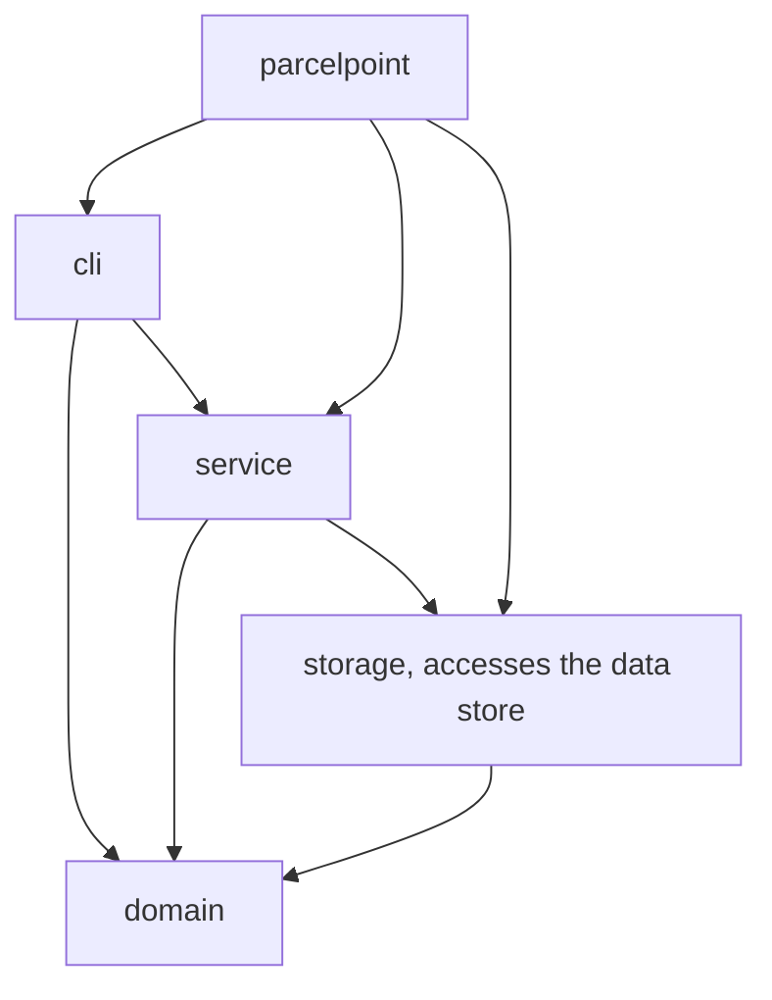
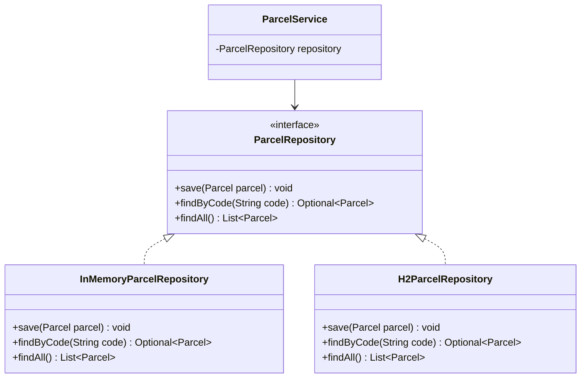
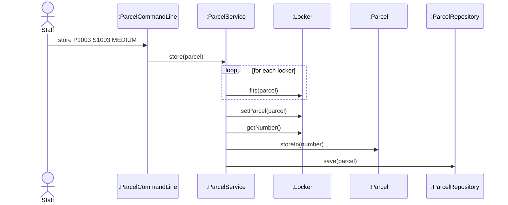

# Lab Report, Designing the Data Management Layer with H2

Repository URL: https://github.com/yellowman0000/itcs382-h2-lab.

## Tools

| Item | Version or name |
| --- | --- |
| JDK | Java 24.0.2 (Oracle HotSpot) |
| Maven | Apache Maven 3.10.0 |
| IDE | Antigravity IDE 2.7.0 |
| AI tool and exact model, if you used one | Antigravity (Gemini 4 Hydrogen High) |

## Part 0. From a store in memory to H2

Commit of the starter, before any change: e12478b

0.3 Your prediction for `staff`, written before the second run:

`staff` will list no parcels and display `Free lockers: 3`, because the parcels stored during the first run disappeared when the program exited.

Output of the second run, for `staff` and `quit`:

```text
> staff
Free lockers: 3
> quit
```

State in one sentence where you think the parcels of the first run were kept.

The parcels from the first run were kept in the program's main memory (RAM) inside a `LinkedHashMap`, which was freed when the program exited.

0.5 The line of Main that you would change to keep the parcels somewhere else:

```java
ParcelRepository repository = new InMemoryParcelRepository();
```

0.6 Commit of the switch to H2: b701e76

0.7 Output of `SELECT * FROM PARCEL;` after you stored two parcels:

```text
sql> SELECT * FROM PARCEL;
CODE  | STUDENT_ID | PARCEL_SIZE | STATUS | LOCKER_NUMBER
P1001 | S1001      | SMALL       | STORED | 1
P1002 | S1002      | LARGE       | STORED | 3
(2 rows, 8 ms)
```

0.8 Explain why ParcelPoint could not start while the H2 Shell was open, and identify the class that wrote the message `Cannot create the PARCEL table`.

ParcelPoint could not start because H2 is an embedded database that locks the database file (`parcelpoint.mv.db`) for exclusive access by the process that opened it; while the H2 Shell still held the file open, a second process could not open it (`Database may be already in use`). The class that wrote `Cannot create the PARCEL table` is `H2ParcelRepository` (in its constructor, when catching `SQLException`).

0.9 Explain why `staff` shows no parcel while `find` shows each one, and why all three lockers look free.

`find` calls `ParcelService.find`, which delegates to `H2ParcelRepository.findByCode` and queries H2 for a matching row, whereas `staff` calls `ParcelService.allParcels`, which delegates to `H2ParcelRepository.findAll`—a stub still returning an empty list (`List.of()`). Because the constructor of `ParcelService` also calls `repository.findAll()` on startup to reload waiting parcels back into their lockers, receiving an empty list leaves all three `Locker` objects empty (`parcel == null`), so `countFreeLockers()` reports all three lockers as free.

0.11 Your findAll method:

```java
    @Override
    public List<Parcel> findAll() {
        String sql = "SELECT * FROM PARCEL ORDER BY CODE";
        List<Parcel> parcels = new ArrayList<>();
        try (Connection connection = connect();
             PreparedStatement statement = connection.prepareStatement(sql);
             ResultSet row = statement.executeQuery()) {
            while (row.next()) {
                parcels.add(toParcel(row));
            }
        } catch (SQLException e) {
            throw new IllegalStateException("Cannot read the parcels", e);
        }
        return parcels;
    }
```

Commit that adds findAll: b7059b6

0.12 Output of `SELECT * FROM PARCEL;` after the pickup:

```text
sql> SELECT * FROM PARCEL;
CODE  | STUDENT_ID | PARCEL_SIZE | STATUS    | LOCKER_NUMBER
P1001 | S1001      | SMALL       | PICKED_UP | null
P1002 | S1002      | LARGE       | STORED    | 3
(2 rows, 7 ms)
```

0.13 Optional. Describe what `find P9999'OR'1'='1` showed while the SQL was joined from strings, and what it showed after you put the placeholder back.

While the SQL statement was built via string concatenation, `find P9999` printed `No parcel with code P9999`, whereas `find P9999'OR'1'='1` printed `P1001, S1001, SMALL, PICKED_UP` because the injected `'1'='1'` condition evaluated to true for every row and returned the first row. After restoring the `?` placeholder and `statement.setString(1, code)`, `find P9999'OR'1'='1` treated the input as a literal code and printed `No parcel with code P9999'OR'1'='1`.

## Part A. Model the design

A1 Complete the flowchart with one node for each package and one arrow for each dependency, from the package that uses to the package that is used. Mark the package that accesses the data store.



State whether cli depends on storage, and explain why.

No, `cli` does not depend on `storage`. `ParcelCommandLine` in `parcelpoint.cli` only imports classes from `parcelpoint.domain` and `parcelpoint.service`; it never imports `ParcelRepository` or any concrete repository class, and accesses parcels indirectly through `ParcelService`.

A2 Complete the class diagram of the data management layer with ParcelService, the interface ParcelRepository with its three operations, and the two classes that implement it.



A3 Draw a sequence diagram for the command `store P1003 S1003 MEDIUM`, from the staff member to the repository. Show each message as an operation of the class that receives it.



Explain why the last lifeline is the interface ParcelRepository rather than H2ParcelRepository.

`ParcelService` depends only on the `ParcelRepository` interface (following the Dependency Inversion Principle) and never names `H2ParcelRepository` in its code. At runtime it sends `save(parcel)` to that interface reference without knowing which concrete repository implementation handles persistence.

## Part B. Design questions

1. Identify the files that you changed to move from the store in memory to H2, and explain why no other class had to change. Use the terms of this course.

Only `Main.java` had to change to switch the store from `InMemoryParcelRepository` to `H2ParcelRepository` (in addition to completing `findAll` inside `H2ParcelRepository.java`). No class in `cli`, `service`, or `domain` had to change because the data management layer is isolated behind the `ParcelRepository` interface, applying the Dependency Inversion Principle and information hiding. `ParcelService` depends only on the abstraction and works solely with `Parcel` domain objects, while `Main` chooses and injects the concrete repository implementation.

2. The PARCEL table stores the size of a parcel as SMALL, MEDIUM or LARGE rather than as 1, 2 or 3. Identify the type of connascence between ParcelSize and the table in each case, and explain which one is weaker.

Storing `SMALL`, `MEDIUM`, or `LARGE` creates connascence of name, because both `ParcelSize` and the `PARCEL` table must agree on the exact constant names (`name()` and `valueOf()`). Storing `1`, `2`, or `3` creates connascence of position (if mapped by enum declaration order) or connascence of convention (if arbitrary numeric codes represent sizes). Connascence of name is weaker because the values in the database are self-describing and remain valid even if the enum constants are reordered, making the coupling easier to see and safer to change.

3. Project Phase 2 asks for a data store that needs no separate server. Explain why an embedded database such as H2 meets this rule, and describe the limit of an embedded database that Step 0.8 showed.

H2 meets this rule because it runs as an in-process Java library (`h2-2.5.252.jar`) inside the application's own JVM and persists data directly to a local file (`./data/parcelpoint.mv.db`), requiring no separate database server process or installation. Its limitation, shown in Step 0.8, is that an embedded H2 database locks the database file for exclusive use by the single process that opened it, so two programs (such as ParcelPoint and the H2 Shell) cannot open the same database file at the same time.

4. State the data store that you would choose for your Project Phase 2 team, files or an embedded database, the requirement that drives the choice, and the package that will access it.

For our Project Phase 2 team, we would choose an embedded database (H2), driven by the requirement that structured domain data must persist across restarts and support reliable queries and updates without running a separate database server (`CREATE TABLE IF NOT EXISTS` handles first-run initialization automatically). All database connections, SQL statements, and row-to-object mappings will be confined to the `storage` package behind repository interfaces so the business and UI layers remain independent of the data store.

## AI usage declaration

| AI tool and exact model | Date | Purpose | Files or answers it produced or changed | How you checked its output |
| --- | --- | --- | --- | --- |
| Antigravity (Gemini 4 Hydrogen High) | 2026-11-14 | Implement `findAll`, switch `Main` to H2, Guidance on lab report `LAB_REPORT.md` | `Main.java`, `H2ParcelRepository.java`, `LAB_REPORT.md` | Built with `mvn -o package`, ran `parcelpoint-h2-1.0.jar` and H2 Shell (`java "@h2shell.txt"`) for all commands, verified `git log` hashes, checked package imports, and reviewed all answers in `LAB_REPORT.md` |
